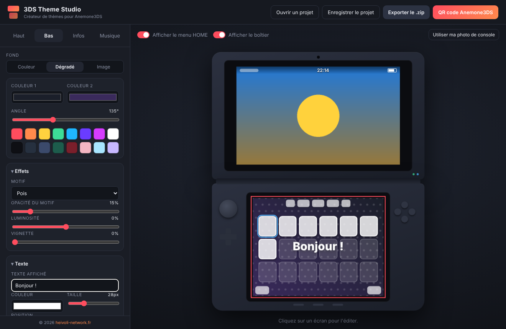

# 3DS Theme Studio

Application **macOS et Windows** pour créer des thèmes de menu HOME 3DS en quelques clics, puis les installer sans câble ni carte SD grâce à un **QR code local** lu par **Anemone3DS**.

© heivoli-network.fr — <https://heivoli-network.fr>



## Fonctionnalités

- **Éditeur visuel** des deux écrans : couleur unie, dégradé ou image (glisser-déposer).
- Cadrage à la souris directement dans l'aperçu (glisser pour déplacer, molette pour zoomer).
- Effets : motifs (pois, rayures, grille, damier, vagues), luminosité, vignette, texte.
- **Aperçu en direct** dans un boîtier, avec les repères du menu HOME (barre d'état, grille d'icônes).
- **Votre propre photo de console** : importez une photo de votre 3DS, calez les deux écrans dessus et voyez le thème « en vrai ».
- Nom, description, auteur et icône du thème (info.smdh).
- Musique de fond `.bcstm` optionnelle.
- **Export .zip** compatible Anemone3DS (`body_LZ.bin`, `info.smdh`, `preview.png`, `bgm.bcstm`).
- **QR code local** : l'application lance un mini-serveur sur votre réseau, la 3DS scanne et télécharge le thème directement.
- Projets enregistrables (`.3dstheme`).
- Aucune dépendance d'exécution : encodeur LZ11, textures RGB565, SMDH, ZIP et QR code écrits from scratch.

## Installer

Téléchargez la dernière version dans l'onglet **Releases** :

| Système | Fichier |
| --- | --- |
| macOS Apple Silicon | `3DS-Theme-Studio-x.y.z-mac-arm64.dmg` |
| macOS Intel | `3DS-Theme-Studio-x.y.z-mac-x64.dmg` |
| Windows (installateur) | `3DS-Theme-Studio-x.y.z-windows-setup.exe` |
| Windows (portable) | `3DS-Theme-Studio-x.y.z-windows-portable.exe` |

> **macOS** : l'application n'est pas signée. Au premier lancement, faites clic droit → **Ouvrir**, ou exécutez
> `xattr -dr com.apple.quarantine "/Applications/3DS Theme Studio.app"`.
>
> **Windows** : SmartScreen peut afficher un avertissement → « Informations complémentaires » → « Exécuter quand même ». Autorisez l'application dans le pare-feu pour le QR code.

## Installer un thème avec le QR code

1. La 3DS (avec Custom Firmware + **Anemone3DS**) et l'ordinateur doivent être sur **le même Wi-Fi**.
2. Dans l'application, cliquez sur **QR code Anemone3DS**.
3. Dans Anemone3DS, appuyez sur **R** pour ouvrir le lecteur QR et visez l'écran.
4. Le thème apparaît dans la liste : sélectionnez-le et appuyez sur **A**.

Sans réseau : **Exporter le .zip** puis copiez-le dans `/Themes/` à la racine de la carte SD.

## Formats

| Élément | Dimensions |
| --- | --- |
| Écran du haut | 412 × 240 px (400 px visibles, marge pour la 3D) |
| Écran du bas | 320 × 240 px |
| Icône | 48 × 48 px (+ 24 × 24 générée) |
| Aperçu | 412 × 480 px |
| Musique | BCSTM, 3,3 Mo max |

## Développement

```bash
npm install
npm start          # lancer l'application
npm test           # tests du moteur (LZ11, textures, SMDH, zip)
npm run dist:mac   # construire le .dmg (sur un Mac)
npm run dist:win   # construire le .exe (sur Windows)
```

Les builds Mac et Windows sont produits automatiquement par **GitHub Actions** à chaque push.
Pour publier une version : `git tag v1.0.0 && git push --tags` → une Release est créée avec les installateurs.

```
src/
  main.js            processus principal (fenêtre, export, serveur local + QR)
  preload.js         pont sécurisé
  lib/               moteur sans dépendance
    lz11.js          compression LZ11
    texture.js       RGB565 tuilé (Morton)
    body.js          body_LZ.bin
    smdh.js          info.smdh
    zip.js           archive zip
    qr.js            encodeur QR code
    theme.js         assemblage du thème
  renderer/          interface (HTML/CSS/JS)
```

## Mentions

Nintendo 3DS est une marque de Nintendo. Ce projet n'est ni affilié ni approuvé par Nintendo.
L'application n'embarque aucun visuel ni élément d'interface de Nintendo : le boîtier et les repères du menu HOME sont des dessins originaux, et la photo de console est celle que vous importez.

© heivoli-network.fr
